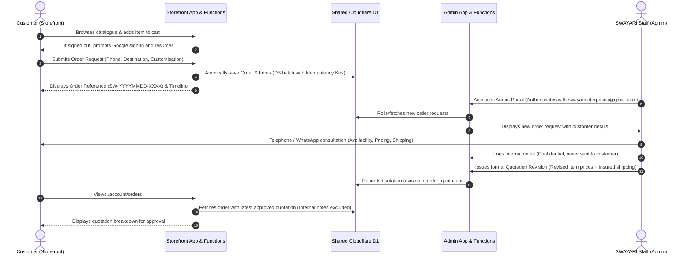

# SWAYARI ENTERPRISES — System Architecture (Two-Portal Platform)

## 1. System Overview

SWAYARI ENTERPRISES is built upon a **free-first, edge-native, two-application architecture** deployed as two independent Cloudflare Pages projects backed by a single shared Cloudflare D1 database.

```mermaid
graph TD
    subgraph Customer Storefront ["apps/storefront (swayari.in / Pages)"]
        StoreBrowser["Customer Browser<br/>(Desktop / Mobile)"]
        StorePages["Storefront Static Assets<br/>(React 18 + Vite + Tailwind)"]
        StoreFunc["Storefront Functions<br/>(/api/products, /api/orders, etc.)"]
        StoreCookie["swayari_customer_session<br/>(Host-only, Scope: customer)"]
    end

    subgraph Admin Portal ["apps/admin (admin.swayari.in / Pages)"]
        AdminBrowser["Staff Browser<br/>(Staff Operations)"]
        AdminPages["Admin Static Assets<br/>(React 18 + Vite + Tailwind)"]
        AdminFunc["Admin Functions<br/>(/api/admin/*)"]
        AdminCookie["swayari_admin_session<br/>(Host-only, Scope: admin)"]
    end

    subgraph Shared Cloudflare Edge Infrastructure
        D1[("Shared Cloudflare D1 Database<br/>(Single Source of Truth)")]
        GoogleOAuth["Google Identity Services<br/>(OAuth 2.0 Web ID Token)"]
    end

    StoreBrowser -->|Static HTML/JS/CSS| StorePages
    StoreBrowser -->|API Calls (Same Origin)| StoreFunc
    StoreBrowser -->|Google ID Token (Storefront Client ID)| GoogleOAuth
    StoreFunc -->|Verify ID Token & Query/Mutate| D1

    AdminBrowser -->|Static HTML/JS/CSS| AdminPages
    AdminBrowser -->|API Calls (Same Origin)| AdminFunc
    AdminBrowser -->|Google ID Token (Admin Client ID)| GoogleOAuth
    AdminFunc -->|Verify ID Token & Query/Mutate| D1

    StoreCookie -.->|Sent to Storefront only| StoreFunc
    AdminCookie -.->|Sent to Admin only| AdminFunc
```

---

## 2. Core Separation Principles

1. **Two Independent Cloudflare Pages Deployments:**
   - **Customer Storefront (`apps/storefront`):** Public browsing, curated collections, product detail gallery, Google sign-in resumption on "Add to Cart", cart drawer/page, order request checkout with mandatory disclaimer, order confirmation, and customer order history.
   - **Admin Operations Portal (`apps/admin`):** Standalone staff operations portal at its own dedicated domain/subdomain, with branded login screen (`swayarienterprises@gmail.com`), dashboard metrics, order request workflow, quotation revision editor, confidential staff notes thread, and product catalogue management.
2. **Strict Storefront Sanitization:**
   - **Zero Admin Links:** The storefront contains no admin navigation, header link, or footer mention.
   - **Zero Admin Frontend Bundles:** Storefront build outputs only customer code.
   - **Zero Deployed Admin API Handlers:** Admin functions do not exist in the storefront deployment. Storefront middleware strictly blocks `/admin` and `/api/admin` with `404 Not Found`.
3. **Dedicated Admin Origin & Strict Noindex:**
   - Admin portal deploys to a separate URL (e.g. `admin.swayari.in` or Pages equivalent).
   - Middleware emits `X-Robots-Tag: noindex, nofollow, noarchive` and `index.html` includes `<meta name="robots" content="noindex, nofollow" />`.
   - Admin routes are omitted from the public sitemap.
4. **Session Scope Isolation:**
   - Database sessions contain a mandatory `scope` column (`'customer'` or `'admin'`).
   - Storefront issues `swayari_customer_session` (14 days, scope `customer`).
   - Admin portal issues `swayari_admin_session` (7 days, scope `admin`).
   - Admin middleware validates that the session is both valid and has `scope === 'admin'` and belongs to an email on the server-side admin allowlist (`swayarienterprises@gmail.com`).
   - A customer session cannot access admin APIs, and an admin session cannot be hijacked from the storefront.

---

## 3. The Catalogue & Order Request Model

### Why No Automated Online Payment Checkout?
1. **Artisanal Devotional Art:** Products are silver-plated framed plaques and heavy bell-metal brassware. Unit weights, frame mouldings, and dimensions vary.
2. **Fragile Transit Protection:** Shipping charges cannot be generalized. Packing fragile devotional art requires multi-layer foam, timber reinforcement, and destination-specific transit insurance.
3. **Customisation:** Customers frequently request custom engraved name plaques, velvet gift wrap, or ceremonial wedding notes.
4. **Mandatory Process Notice:**
   > *“Our team will contact you to confirm availability, final pricing, shipping charges and delivery details. Submitting this request does not confirm a purchase or reserve stock.”*

### End-to-End Customer & Admin Workflow


---

## 4. Monorepo Structure

```
SWAYARI-ENTERPRISES/
├── apps/
│   ├── storefront/                 # Customer Web Application
│   │   ├── src/                    # React 18 + TS (Header, Hero, ProductCard, Cart, etc.)
│   │   ├── functions/              # Storefront Cloudflare Pages Functions
│   │   │   ├── _middleware.js      # Security headers + 404 on /admin and /api/admin
│   │   │   ├── api/auth/           # Customer Google Auth & Session handlers
│   │   │   ├── api/products/       # Public catalogue endpoints
│   │   │   ├── api/categories/     # Category summary endpoint
│   │   │   └── api/orders/         # Atomic order request submission & customer orders
│   │   ├── index.html              # Storefront HTML shell with SEO meta & fonts
│   │   ├── vite.config.ts          # Vite configuration building to apps/storefront/dist
│   │   └── tailwind.config.js      # Storefront Tailwind configuration
│   └── admin/                      # Admin Operations Portal
│       ├── src/                    # React 18 + TS (LoginPage, Dashboard, Orders, Quotations)
│       ├── functions/              # Admin Cloudflare Pages Functions
│       │   ├── _middleware.js      # Security headers + Strict noindex headers
│       │   ├── api/auth/           # Admin Google Auth (swayarienterprises@gmail.com)
│       │   └── api/admin/          # Stats, Orders, Quotations, Notes, Products, Assets
│       ├── index.html              # Admin HTML shell with robots noindex
│       ├── vite.config.ts          # Vite configuration building to apps/admin/dist
│       └── tailwind.config.js      # Admin Tailwind configuration
├── packages/
│   ├── shared/                     # Shared types, constants, formatters, validation
│   ├── server/                     # Edge utilities (session verification, cookies, audit)
│   └── ui/                         # Design system tokens and Tailwind preset
├── migrations/                     # Canonical D1 SQL migrations
│   ├── 0001_initial_schema.sql     # Core tables (users, orders, products, etc.)
│   ├── 0002_demo_data.sql          # Sample products (tagged is_demo = 1)
│   ├── 0003_session_scope.sql      # Multi-portal session scope column
│   └── 0004_preview_catalogue.sql  # Honest sample entries for the four supplied product photos (is_demo = 1)
├── public/assets/                  # CANONICAL Git-tracked assets: brand/, products/, demo/ (originals), editorial/ (licensed stock)
│                                   #   copied into apps/*/public/assets by scripts/sync-assets.js at build time
│                                   #   (editorial/ goes to the storefront only)
├── scripts/                        # Manifest generator, test suite, backup automation
└── docs/                           # System architecture, design system, handoff
```

---

### Legacy single-origin files

`functions/` and the HTML/JS/CSS pages under `public/` at the repository root are the Milestone 1
single-origin application (it includes admin handlers next to customer ones). They are not part of
either portal's deployment once each Cloudflare Pages project uses its app folder as the root
directory, and the root `wrangler.toml` no longer declares a Pages output. They are kept only until
the owner approves removing them (see Milestone 3 open issues).

---

## 5. Security & Isolation Controls

1. **Portal-Scoped Cookies:**
   - Storefront: `swayari_customer_session`, `Path=/`, `HttpOnly`, `Secure`, `SameSite=Lax`, 14-day expiry.
   - Admin Portal: `swayari_admin_session`, `Path=/`, `HttpOnly`, `Secure`, `SameSite=Lax`, 7-day expiry.
   - No cross-subdomain wildcard cookie sharing.
2. **Server-Enforced Admin Allowlist:**
   - Admin authentication binds directly to Google's verified `sub` and checks against the server allowlist (`swayarienterprises@gmail.com`).
   - Browser cannot supply roles or elevation flags.
3. **Audience Validation (Google ID Token):**
   - Storefront validates against `GOOGLE_STOREFRONT_CLIENT_ID`.
   - Admin portal validates against `GOOGLE_ADMIN_CLIENT_ID`.
   - Each portal publishes only its own client ID to the browser via `GET /api/auth/config`.
   - A customer token cannot authenticate against the admin endpoint.
4. **Customer Data Isolation:**
   - Storefront endpoint `/api/orders/:id` strictly checks `order.customer_id === session.user.id`. Customer B cannot view Customer A's records.
5. **Confidential Internal Notes:**
   - Staff telephone notes in `order_internal_notes` are accessible only through `/api/admin/orders/:id` and are completely omitted from storefront queries and DTOs.
6. **Server-Side Price Recalculation:**
   - Indicative item prices are read directly from the database at submission time; client-supplied prices are discarded.
7. **Idempotency Protection:**
   - Each order submission requires an `idempotencyKey`. Duplicate submissions return the existing order record without duplicating rows.
