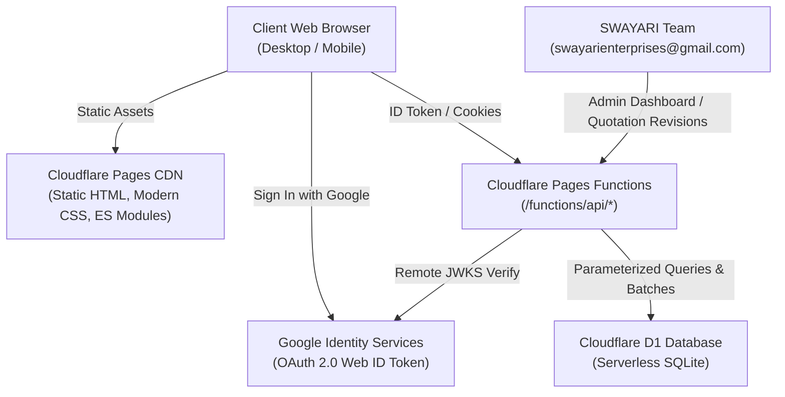
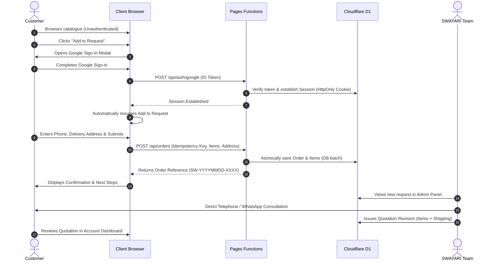
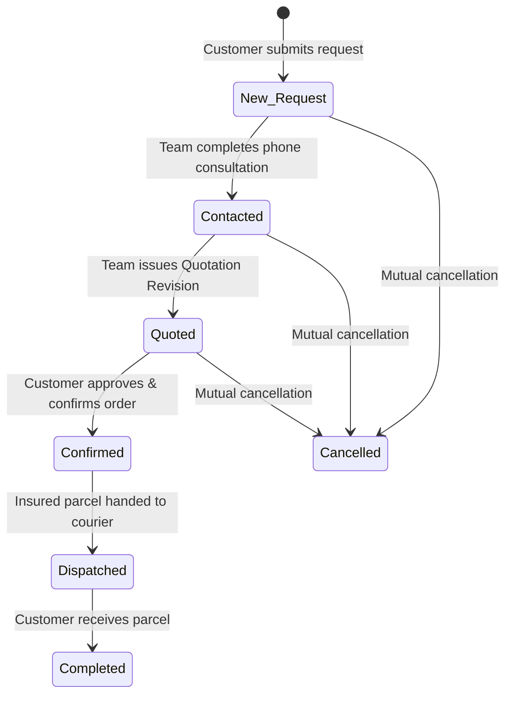

# SWAYARI ENTERPRISES — System Architecture

## 1. System Overview

SWAYARI ENTERPRISES is built upon a **free-first, edge-native, zero-bloat architecture** using Cloudflare Pages, Cloudflare Pages Functions, and Cloudflare D1.

---

## 2. The Catalogue & Order Request Model

### Why No Automated Online Payment Checkout?
1. **Artisanal Devotional Art:** Products are silver-plated framed plaques and heavy bell-metal brassware. Unit weights, frame mouldings, and dimensions vary.
2. **Fragile Transit Protection:** Shipping charges cannot be generalized. Packing fragile devotional art requires multi-layer foam, timber reinforcement, and destination-specific transit insurance.
3. **Customisation:** Customers frequently request custom engraved name plaques, velvet gift wrap, or ceremonial wedding notes.
4. **Mandatory Process Notice:**
   > *“Our team will contact you to confirm availability, final pricing, shipping charges and delivery details. Submitting this request does not confirm a purchase or reserve stock.”*

### Customer Journey Workflow

---

## 3. Database Schema (D1)

The database schema is strictly versioned under `migrations/`:

### Core Tables
1. **`users`**: Stores stable Google subject identifier (`sub`), verified email, name, avatar, and assigned role (`'customer'` or `'admin'`).
2. **`sessions`**: 256-bit cryptographically random tokens with explicit 14-day expiry.
3. **`categories`**: Product classifications with display ordering and active toggles.
4. **`products`**: Catalogue items including SKU, URL slug, dimensions, confirmed material, indicative price (nullable for "Price on Request"), minimum quantity, status (`'draft'`, `'published'`, `'archived'`), and demo flag (`is_demo = 1`).
5. **`orders`**: Customer order requests with unique `idempotency_key`, contact phone, shipping destination, initial indicative subtotal, and status.
6. **`order_items`**: Immutable snapshot of product SKU, name, indicative price, quantity, and customisation note taken at the exact moment of request submission.
7. **`order_quotations`**: Versioned formal quotations issued by the admin team. Contains agreed item unit prices, insured shipping charge, applicable taxes, and consultation notes.
8. **`order_internal_notes`**: Confidential administrative notes entered during telephone calls. **Completely isolated and omitted from customer APIs.**
9. **`audit_logs`**: Chronological record of status changes, quotation issuances, product edits, and logins.

---

## 4. Order Status Lifecycle

---

## 5. Security & Isolation Controls

1. **Customer Data Isolation:** Every customer query for `/api/orders/:id` enforces `order.customer_id === session.user.id`. Customer B cannot view Customer A's orders.
2. **Internal Note Protection:** The `order_internal_notes` table is queried only in `/api/admin/orders/:id` behind `requireAdmin`.
3. **Re-calculating Prices:** The client browser never supplies final prices. The server re-reads indicative prices from the database at the time of request submission.
4. **Idempotency Protection:** Submissions include a client-generated `idempotencyKey`. If a customer double-clicks or retries, the server returns the existing order reference rather than duplicating rows.
5. **Google ID Token RFC Compliance:** Verified using `jose` with Google's JWKS (`https://www.googleapis.com/oauth2/v3/certs`), validating signature, expiration, issuer, audience (`GOOGLE_CLIENT_ID`), and `email_verified`.
